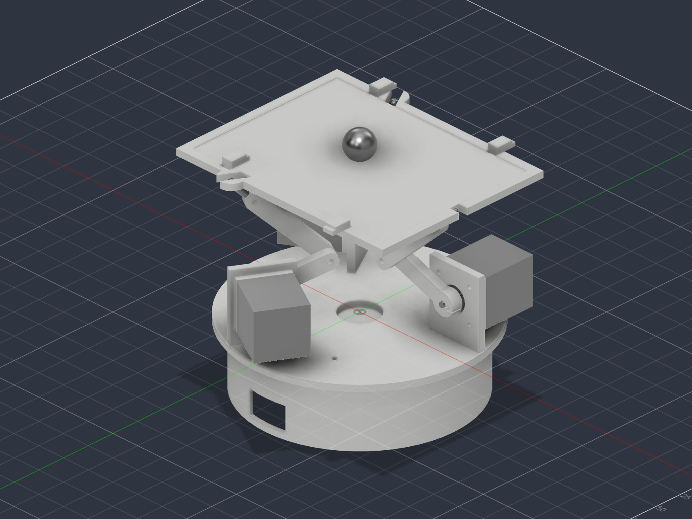
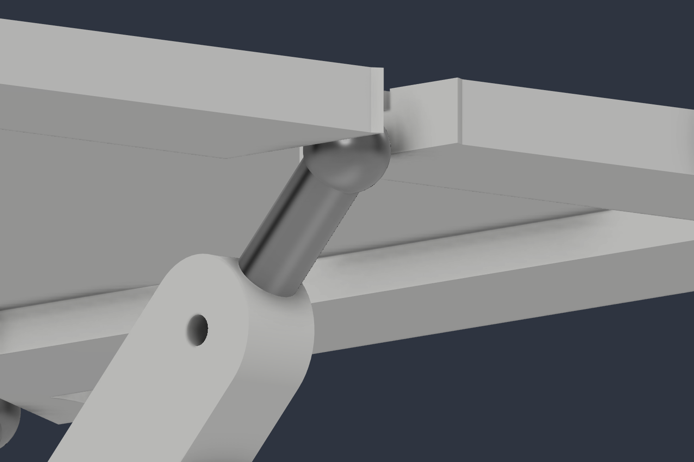

# Ball Balancer

A 1 inch steel ball balanced on a tilting platform by three stepper motors.
A resistive touch panel reports where the ball is, two PID loops decide how
the platform should tilt, and inverse kinematics turn that tilt into three
crank angles.



The mechanism is a **3RRS parallel manipulator**. Three legs, each with two
revolute joints and a spherical one at the top, give the platform three
degrees of freedom: height, roll and pitch. Reimplemented from
[aaedmusa's Instructables write-up](https://www.instructables.com/Ball-Balancer/)
with original CAD and firmware. See [`NOTICE`](NOTICE).

> **Nothing here has been built.** The CAD is checked, the kinematics are
> verified and the firmware compiles, but no part has been printed and no
> motor has turned. [`docs/validation.md`](docs/validation.md) is specific
> about what that means.

## The machine

| | |
|---|---|
| Platform height, level | 119.4 mm |
| Vertical travel | 84.7 mm |
| Tilt envelope | plus or minus 15 degrees, any direction |
| Resolution | 0.085 degrees of tilt per microstep |
| Control loop | 50 Hz |
| Printed mass | about 282 g of PLA at 20% infill |
| Platform | 209 by 163 mm, carrying an 8.4 inch panel |

Three NEMA 17 steppers sit on vertical flanges that are part of the base
plate, with their axes horizontal and tangential. That arrangement is what
makes each crank sweep in its own vertical slice through the machine, which
is what the kinematics assume.



Each leg runs motor, crank, coupler, tie rod, platform. The ball end at the
top sits in a clevis on the platform ear, and it is the joint that lets the
platform tilt in two axes while the crank only rotates in one.

## Repository layout

| Path | Contents |
|---|---|
| `cad/` | Fusion archive, STEP, STLs, DXFs, renders, build report |
| `cad/scripts/BallBalancer/` | the script that builds the whole design |
| `cad/parameters.md` | every driving dimension, with the reasoning |
| `firmware/BallBalancer/` | the control firmware |
| `firmware/StepperTest/` | motor direction check |
| `electronics/wiring.md` | pin map, power, and a correction to the source |
| `docs/` | BOM, assembly, calibration, tuning, troubleshooting, validation |
| `tools/verify_kinematics.py` | checks the inverse kinematics against forward |

## Building one

1. [`docs/bom.md`](docs/bom.md) for what to buy. Measure your touch panel
   before printing anything.
2. Print the seven parts from `cad/mesh/`.
3. [`electronics/wiring.md`](electronics/wiring.md) for the circuit. **Read
   the TMC2208 supply pin note before applying power.**
4. [`docs/assembly.md`](docs/assembly.md) for the build order.
5. [`docs/calibration.md`](docs/calibration.md) to get the panel reading
   correctly.
6. [`docs/tuning.md`](docs/tuning.md) to make it balance.

If anything misbehaves, [`docs/troubleshooting.md`](docs/troubleshooting.md)
works down from power to motors to sensing to control.

## Rebuilding the CAD

The design is script driven. `cad/scripts/BallBalancer/BallBalancer.py`
creates a new Fusion document, builds every component from the parameter
block at the top, runs interference analysis at three poses, and writes the
F3D, STEP, STLs, DXFs and renders.

Copy the folder to your Fusion scripts directory, then run it from Utilities,
Add-Ins, Scripts and Add-Ins. It takes about a minute and writes a log and a
JSON report alongside the exports.

To change the machine, edit the `P` dictionary at the top of that script and
run it again. Then update `firmware/BallBalancer/Config.h` and
`tools/verify_kinematics.py` to match, and run:

```bash
python tools/verify_kinematics.py
```

That script checks the inverse kinematics against forward kinematics across
the whole working envelope. It earned its place: it caught a geometry where
a 10 degree tilt drove one leg past its mechanical stop.

## Validation status

Checked:

- Inverse kinematics against forward kinematics, 401 points, worst error
  2.8e-14 mm
- Tilt envelope, 384 poses to 15 degrees, none outside crank travel
- Fusion interference analysis at fully down, home and fully up: **zero**
  overlapping pairs at all three
- Running clearances at both rotating joints: 2.0 mm and 1.5 mm
- Both sketches compile for the Teensy 4.1 with no warnings

Not checked, because it has not been built:

- The PID gains, which are starting values, not tuned ones
- Touch panel calibration, which is per panel and must be measured
- Printability, since the STLs have not been through a slicer
- Panel dimensions, which are typical values rather than measured

Full detail in [`docs/validation.md`](docs/validation.md).

## Licence

Split, because the sources differ.

| Part | Licence |
|---|---|
| `cad/`, `docs/`, `electronics/` | [CC BY-NC-SA 4.0](LICENSE-CC-BY-NC-SA-4.0.md) |
| `firmware/`, `tools/` | [MIT](LICENSE) |

The CAD and documentation derive from a CC BY-NC-SA 4.0 source, so they carry
the same share-alike, non-commercial terms. The firmware was written from
scratch and is MIT. [`NOTICE`](NOTICE) has the attribution and explains what
is and is not redistributed here.
